<div align="center">



# Hi 👋, I'm Goutham Sukamanchi

### CSE Student | AI/ML Engineer in Training 🤖

<a href="https://git.io/typing-svg">
  
</a>

<br/>


</div>

---

## `> whoami`

```yaml
name:      Goutham Sukamanchi
role:      CSE Student | AI/ML Engineer in Training
focus:     [ Machine Learning, Computer Vision, Generative AI, RAG ]
building:  Practical AI systems that actually work
mode:      Learning • Building • Shipping
status:    🟢 Online & open to opportunities
```

I'm a Computer Science student who loves building **practical AI-powered applications** and intelligent software systems, from local LLM assistants to real-time computer vision pipelines.

---

## 🛰️ `> tech_stack --load`

<div align="center">

**Languages**


**AI / ML & Libraries**


**Backend, Tools & Databases**


</div>

> Also working with: **YOLO • Ollama • Qwen 2.5 Coder • RAG • REST APIs • JDBC**

---

## 🚀 `> ls ./featured_projects`

<table>
<tr>
<td width="50%" valign="top">

### 🧠 CodeMind
**AI Codebase Assistant**

Ask questions about any source-code repository in natural language using Retrieval-Augmented Generation, powered by a local LLM.

`Java` `Spring Boot` `RAG` `Ollama` `Qwen 2.5 Coder`

- Repository source-code scanning
- RAG-based code retrieval
- Local LLM integration
- Interactive web interface

[](https://github.com/gouthamsukamanchi-ship-it/codemind-ai-codebase-assistant)

</td>
<td width="50%" valign="top">

### 👁️ AI Face Recognition Attendance
**Real-time vision system**

Detects and recognizes registered students, displays their details and logs attendance automatically.

`Python` `YOLO` `OpenCV` `Face Recognition`

- Real-time person detection
- Face recognition & identification
- Student details overlay
- Excel-based attendance records

[](https://github.com/gouthamsukamanchi-ship-it/AI-Face-Recognition-Attendance-System)

</td>
</tr>
<tr>
<td colspan="2" valign="top">

### 🎙️ Buddy AI
**Futuristic local AI personal assistant**

Voice-activated assistant with speech recognition, conversational AI and an interactive HUD interface.

`Java` `JavaFX` `Vosk` `Ollama`

[](https://github.com/gouthamsukamanchi-ship-it/buddy-ai-personal-assistant)

</td>
</tr>
</table>

---

## 📊 `> github --stats`

<div align="center">


</div>

<div align="center">

</div>

---

## 🧭 `> roadmap --current`

```text
Artificial Intelligence
        ↓
Machine Learning
        ↓
Generative AI
        ↓
RAG & LLM Applications
        ↓
Backend Engineering
        ↓
Production-Ready AI Systems   ← 🎯 destination
```

**📚 Currently learning:** DSA • Advanced ML • Generative AI • RAG • System Design • Backend Development

**🎯 Working toward:** production-oriented AI apps • intelligent developer tools • open-source contributions • AI/ML engineering roles

---

## 📡 `> connect --me`

<div align="center">

[](https://www.linkedin.com/in/goutham-sukamanchi-b969212a2/)
[](https://github.com/gouthamsukamanchi-ship-it)

<br/>


</div>
